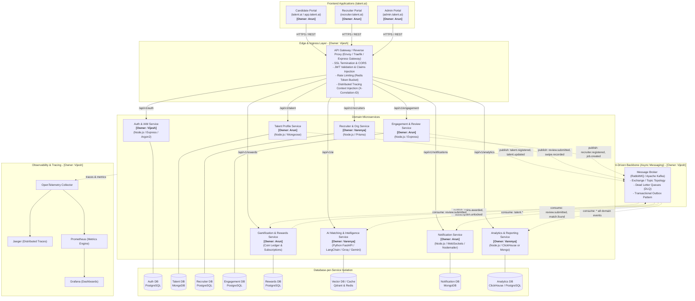
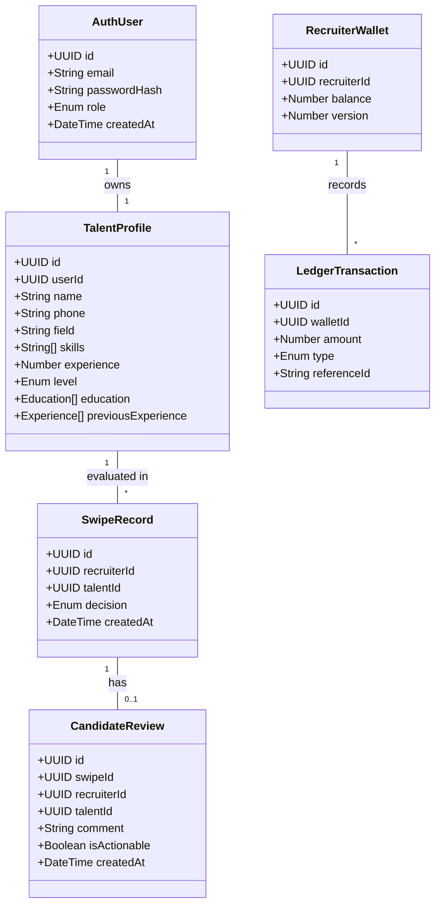

# 🚀 talent.ai — Microservices Transformation & Rebranding Master Plan

> **Project Transformation Roadmap:** Converting the monolithic **Smart Match** recruitment platform into a resilient, event-driven, production-grade **Microservices Architecture**, and executing a full brand overhaul to **talent.ai**.
>
> **Project Directory**: [`./smart-match/`](file:///Users/vijeshshetty/Documents/projects/smart-match/)

---

## 👥 Team Workload & Ownership Matrix

| Engineer | Primary Focus Areas | Owned Microservices & Modules | Key Milestones & Phases |
| :--- | :--- | :--- | :--- |
| **Vijesh**<br/>`@vijesh` | **Platform Architecture, Security & DevOps** | • `services/api-gateway`<br/>• `services/auth-service`<br/>• `packages/event-bus`<br/>• Infrastructure (`Docker`, `K8s`, `RabbitMQ`, `Redis`) | • Phase 0 (Monorepo & Infra setup)<br/>• Phase 1 (Gateway & IAM Auth)<br/>• Phase 9 (Observability, Security & CI/CD)<br/>• Production Deployment |
| **Varenya**<br/>`@varenya` | **AI Systems, Analytics & Recruiter Domain** | • `services/ai-matching-service`<br/>• `services/recruiter-service`<br/>• `services/analytics-service`<br/>• Vector DB (`Qdrant` / `pgvector`) | • Phase 3 (Recruiter & Org Service)<br/>• Phase 6 (AI Engine, Embeddings & TalentLens)<br/>• Phase 7.2 (Analytics & Funnel Metrics)<br/>• Phase 10.1 (Data Migration Script) |
| **Arun**<br/>`@arun` | **Talent Domain, Engagement, Gamification & Frontends** | • `services/talent-service`<br/>• `services/engagement-service`<br/>• `services/rewards-service`<br/>• `services/notification-service`<br/>• `apps/candidate-portal`<br/>• `apps/recruiter-portal`<br/>• `packages/ui` & `packages/api-client` | • Phase 0.3 (Brand Assets & UI Tokens)<br/>• Phase 2 (Talent Profile Service)<br/>• Phase 4 (Engagement & Swipes)<br/>• Phase 5 (Rewards & Sagas)<br/>• Phase 7.1 (Notifications)<br/>• Phase 8 (Frontend Portals & Rebrand)<br/>• Phase 10.2 (E2E Integration Tests) |

---

## 📋 Table of Contents
1. [Architecture Overview & Target Topology](#-architecture-overview--target-topology)
2. [Domain-Driven Design (DDD) & Bounded Contexts](#-domain-driven-design-ddd--bounded-contexts)
3. [Rebranding Blueprint: Smart Match → talent.ai](#-rebranding-blueprint-smart-match--talentai)
4. [Microservices Architectural Patterns Implemented](#-microservices-architectural-patterns-implemented)
5. [Target Service Inventory & Database Isolation](#-target-service-inventory--database-isolation)
6. [Phase-by-Phase Implementation Checklist (with Assignees)](#-phase-by-phase-implementation-checklist)
   - [Phase 0: Workspace Setup, Monorepo & Rebranding Foundations](#phase-0-workspace-setup-monorepo--rebranding-foundations)
   - [Phase 1: Infrastructure, API Gateway & IAM / Auth Service](#phase-1-infrastructure-api-gateway--iam--auth-service)
   - [Phase 2: Talent Profile Service (Candidate Domain Extraction)](#phase-2-talent-profile-service-candidate-domain-extraction)
   - [Phase 3: Recruiter & Organization Service](#phase-3-recruiter--organization-service)
   - [Phase 4: Engagement & Review Service (Decoupling Swipes & Feedback)](#phase-4-engagement--review-service-decoupling-swipes--feedback)
   - [Phase 5: Gamification & Rewards Service (Coin Ledger & Subscriptions)](#phase-5-gamification--rewards-service-coin-ledger--subscriptions)
   - [Phase 6: AI & Matching Intelligence Service (Async Worker & Semantic Search)](#phase-6-ai--matching-intelligence-service-async-worker--semantic-search)
   - [Phase 7: Notification & Analytics Services](#phase-7-notification--analytics-services)
   - [Phase 8: Frontend Modernization & talent.ai UI Revamp](#phase-8-frontend-modernization--talentai-ui-revamp)
   - [Phase 9: Observability, Resilience, Security & DevOps](#phase-9-observability-resilience-security--devops)
   - [Phase 10: Data Migration, Integration Testing & Production Cutover](#phase-10-data-migration-integration-testing--production-cutover)
7. [Distributed Event Catalog & Message Schemas](#-distributed-event-catalog--message-schemas)
8. [Data Migration & Decoupling Strategy](#-data-migration--decoupling-strategy)

---

## 🏛 Architecture Overview & Target Topology



---

## 🧩 Domain-Driven Design (DDD) & Bounded Contexts

| Bounded Context | Domain Scope | Primary Entities & Aggregates | Target Service | Lead Assignee |
| :--- | :--- | :--- | :--- | :--- |
| **Identity & Access** | Authentication, authorization, token lifecycle, RBAC | `User`, `Account`, `RefreshToken`, `Role`, `Permission` | `auth-service` | **Vijesh** |
| **API Gateway & Routing** | Edge proxy, rate limiting, SSL, token validation, correlation | `GatewayRoute`, `RateLimitRule`, `TokenPayload` | `api-gateway` | **Vijesh** |
| **Talent / Candidate** | Candidate profiles, skills taxonomy, education, work experience, level categorization | `TalentProfile`, `Skill`, `Education`, `WorkExperience`, `TalentLevel` | `talent-profile-service` | **Arun** |
| **Recruiter & Org** | Recruiter accounts, company affiliations, hiring criteria, job postings | `Recruiter`, `Organization`, `JobPosting`, `SubscriptionTier` | `recruiter-service` | **Varenya** |
| **Engagement & Interaction** | Recruiter swipe actions (right/left), review comments, candidate feedback | `SwipeInteraction`, `Review`, `Feedback`, `Decision` | `engagement-service` | **Arun** |
| **Gamification & Rewards** | HR coin ledger, coin awards, redemption for tier-3 access, platform subscriptions | `CoinLedger`, `CoinTransaction`, `RewardRule`, `Subscription` | `rewards-service` | **Arun** |
| **AI & Matching Intelligence** | Natural language filtering, fit scoring, profile summarization, career recommendations | `MatchEvaluation`, `TalentSummary`, `CareerSuggestion`, `EmbeddingVector` | `ai-matching-service` | **Varenya** |
| **Notifications** | Async in-app alerts, emails to candidates on review, recruiter match alerts | `Notification`, `NotificationTemplate`, `DeliveryStatus` | `notification-service` | **Arun** |
| **Analytics & Reporting** | Funnel conversion, swipe ratios, skill demand metrics, leaderboard | `HiringMetric`, `FunnelAggregate`, `SkillAnalytics` | `analytics-service` | **Varenya** |
| **Frontend Applications** | Candidate Portal, Recruiter Portal, Shared UI tokens, API client | `WebClient`, `CandidateApp`, `RecruiterApp` | `apps/*` | **Arun** |

---

## 🎨 Rebranding Blueprint: Smart Match → talent.ai

### Brand Identity Matrix
- **Brand Name**: `talent.ai`
- **Tagline**: *"Intelligent Hiring & Career Acceleration at the Speed of Thought"*
- **Candidate Portal Pitch**: *"Accelerate your tech career with AI-driven profile insights and smart matching."*
- **Recruiter Portal Pitch**: *"Discover, evaluate, and hire verified high-signal talent in seconds with AI-assisted review."*
- **Core Feature Renaming**:
  - `Jobify` (Swipe card review) ➔ **TalentSwipe™** (or **QuickMatch**)
  - `Filterify` (Natural language candidate search) ➔ **TalentLens™** (AI Semantic Query)
  - `Level 1 / 2 / 3 Candidates` ➔ **Verified Talent Tiers** (`Junior Fellow`, `Pro Engineer`, `Elite Principal`)
  - `Smart Match Coins` ➔ **TalentCredits (TC)**

### Rebranding Inventory Checklist
- [x] **Domain & Configuration** `[Assignee: Vijesh]`:
  - [x] Replace `smartmatch` in database names, docker network names, container labels, and connection strings.
  - [x] Update frontend environment variables (`VITE_APP_NAME="talent.ai"`, `VITE_SITE_URL="https://talent.ai"`).
- [x] **HTML & Meta Tags** `[Assignee: Arun]`:
  - [x] `apps/candidate-portal/index.html`: Update `<title>talent.ai — Candidate Career Portal</title>`, meta description, OpenGraph tags, and favicon.
  - [x] `apps/recruiter-portal/index.html`: Update `<title>talent.ai — Recruiter & Talent Acquisition Platform</title>`, meta description, OpenGraph tags, and favicon.
- [x] **UI Components & Branding Assets** `[Assignee: Arun]`:
  - [x] Design and generate modern SVG logos for **talent.ai** (dark & light variants, icon-only mark, full wordmark).
  - [x] `apps/candidate-portal/src/components/Layout.tsx`: Update navbar brand text to `talent.`<span className="gradient-text">ai</span>.
  - [x] `apps/recruiter-portal/src/components/Sidebar.tsx`: Update sidebar brand text to `talent.`<span className="gradient-text">ai</span> `Recruiter`.
  - [x] `apps/candidate-portal/src/components/Landing.tsx`: Replace all "Smart Match" copy with "talent.ai".
  - [x] `apps/recruiter-portal/src/pages/Home.tsx`: Replace "Welcome to SmartMatch" with "Welcome to talent.ai".
- [x] **Backend Ping Responses** `[Assignee: Vijesh]`:
  - [x] `candidate/backend/index.js` & `hr/backend/index.js`: Replace root ping responses (`talent.ai API Gateway / Microservice v1.0`).
  - [x] Replace demo mock copy, placeholders, and footer credits to reflect `talent.ai`.

---

## ⚙️ Microservices Architectural Patterns Implemented

1. **Database-per-Service** *(All Engineers)*:
   - Zero cross-service database access. Each service encapsulates its own persistence store.
   - Cross-domain data is queried via REST/gRPC or populated asynchronously via event subscriptions.
2. **API Gateway & Backend-for-Frontend (BFF)** *(Lead: Vijesh)*:
   - Single entry point (`api.talent.ai`) shielding internal microservice network topology.
   - Enforces authentication, request validation, rate limiting, and request routing.
3. **Event-Driven Architecture (EDA)** *(Lead: Vijesh & Arun)*:
   - Asynchronous inter-service communication over RabbitMQ or Kafka using AMQP/Kafka protocols.
   - Domain events decouple heavy workflows (e.g. reward distribution, AI indexing, notifications).
4. **Transactional Outbox Pattern** *(Lead: Vijesh)*:
   - Prevents dual-write inconsistencies between database mutations and message publishing. Events are committed atomically with business transactions into an `outbox` table and relayed to the broker.
5. **Saga Pattern (Orchestration/Choreography)** *(Lead: Arun)*:
   - Distributed transactions for multi-step workflows (e.g. unlocking Elite Tier-3 candidates: check coin balance ➔ reserve coins ➔ grant access ➔ debit coins ➔ emit notification; with rollback on failure).
6. **Circuit Breaker & Graceful Degradation** *(Lead: Varenya & Vijesh)*:
   - Wraps downstream calls (e.g., Groq / Gemini LLM API, remote microservice calls) with timeouts, error thresholds, and cached fallbacks to prevent cascading failures.
7. **Command Query Responsibility Segregation (CQRS)** *(Lead: Varenya)*:
   - Write models handle strict transactional consistency (e.g. Candidate Registration, Reviews); Read models provide fast denormalized views for recruiter swipe queues and search.
8. **Distributed Tracing & Correlation IDs** *(Lead: Vijesh)*:
   - OpenTelemetry W3C trace context (`traceparent`, `X-Correlation-ID`) propagated from the API Gateway across every HTTP request and message broker header.

---

## 🗄 Target Service Inventory & Database Isolation

| # | Service Directory | Tech Stack | Port | Database | Primary Responsibility | Assigned Lead |
| :- | :--- | :--- | :- | :--- | :--- | :--- |
| **0** | `services/api-gateway` | Express / Traefik / Envoy | 8080 | Redis (Rate Limiting & Sessions) | Entry point, routing, auth guard, rate limit, CORS | **Vijesh** |
| **1** | `services/auth-service` | Node.js / Express / TypeScript | 5001 | PostgreSQL (`talent_auth`) | User accounts, credentials, JWT issue/refresh, RBAC | **Vijesh** |
| **2** | `services/talent-service` | Node.js / Express / TypeScript | 5002 | MongoDB (`talent_profiles`) | Candidate profile management, resumes, skill tags, tiers | **Arun** |
| **3** | `services/recruiter-service` | Node.js / Express / TypeScript | 5003 | PostgreSQL (`talent_recruiter`) | Recruiter profiles, company info, hiring requisitions | **Varenya** |
| **4** | `services/engagement-service`| Node.js / Express / TypeScript | 5004 | PostgreSQL (`talent_engagement`) | Swipes (approve/reject), reviews, feedback records | **Arun** |
| **5** | `services/rewards-service` | Node.js / Express / TypeScript | 5005 | PostgreSQL (`talent_rewards`) | TalentCredits ledger, coins for feedback, unlocks | **Arun** |
| **6** | `services/ai-matching-service`| Python FastAPI / Node.js | 5006 | Qdrant (Vector DB) + Redis | LLM analysis, TalentLens semantic search, summaries | **Varenya** |
| **7** | `services/notification-service`| Node.js / TypeScript | 5007 | MongoDB (`talent_notif`) | Email alerts, in-app WebSocket notifications | **Arun** |
| **8** | `services/analytics-service` | Node.js / TypeScript | 5008 | PostgreSQL / ClickHouse | Telemetry, hiring conversion stats, talent insights | **Varenya** |
| **9** | `apps/candidate-portal` | React / Vite / Tailwind / TS | 3000 | Client Browser | Rebranded talent.ai candidate web app | **Arun** |
| **10**| `apps/recruiter-portal` | React / Vite / Tailwind / TS | 3001 | Client Browser | Rebranded talent.ai recruiter web app | **Arun** |

---

## 📝 Phase-by-Phase Implementation Checklist

### Phase 0: Workspace Setup, Monorepo & Rebranding Foundations
- [x] **0.1 Monorepo Structuring** `[Assignee: Vijesh]`:
  - [x] Initialize a Turborepo / pnpm workspace structure:
    ```
    talent-ai/
    ├── apps/
    │   ├── candidate-portal/        # Rebranded candidate frontend
    │   └── recruiter-portal/        # Rebranded HR frontend
    ├── services/
    │   ├── api-gateway/             # Gateway & Reverse Proxy
    │   ├── auth-service/            # Authentication & IAM
    │   ├── talent-service/          # Candidate & Talent profile management
    │   ├── recruiter-service/       # Recruiter & Org management
    │   ├── engagement-service/      # Swipes, Reviews & Feedback
    │   ├── rewards-service/         # Coins & Tier-3 Subscriptions
    │   ├── ai-matching-service/     # LLM, Vector Embeddings & Summaries
    │   ├── notification-service/    # WebSockets & Email notifications
    │   └── analytics-service/       # Aggregated dashboards & stats
    ├── packages/
    │   ├── shared-types/            # Shared TypeScript DTOs & Interfaces
    │   ├── event-bus/               # RabbitMQ publisher/consumer wrappers
    │   ├── logger/                  # Structured Pino/Winston logging with tracing
    │   └── ui/                      # Shared Tailwind design tokens & UI library
    ├── infrastructure/
    │   ├── docker/                  # Dockerfiles & Compose files
    │   └── k8s/                     # Kubernetes manifests
    └── scripts/                     # Seeders & data migration scripts
    ```
  - [x] Create root `package.json` with workspace configuration (`workspaces: ["apps/*", "services/*", "packages/*"]`).
  - [x] Configure root `turbo.json` for pipeline caching (`build`, `lint`, `test`, `dev`).
- [x] **0.2 Shared Packages Setup** `[Assignees: Vijesh & Arun]`:
  - [x] `packages/shared-types`: Setup shared TypeScript interfaces for DTOs, Event models, and API responses. `[Assignee: Arun]`
  - [x] `packages/logger`: Setup structured JSON logger (Pino/Winston) with `correlationId` and `serviceName`. `[Assignee: Vijesh]`
  - [x] `packages/event-bus`: Setup RabbitMQ publisher/consumer module with auto-reconnect, Dead-Letter Exchange (DLX), and message typing. `[Assignee: Vijesh]`
- [x] **0.3 Global Rebranding Audit & Asset Preparation** `[Assignee: Arun]`:
  - [x] Design SVG brand assets (`talent-ai-logo.svg`, `talent-ai-mark.svg`, `favicon.svg`).
  - [x] Update color palette variables in Tailwind (`accent-cyan`, `accent-violet`, `talent-primary`, `talent-dark`).
  - [x] Draft unified brand guidelines in `docs/BRAND_GUIDELINES.md`.

---

### Phase 1: Infrastructure, API Gateway & IAM / Auth Service
- [ ] **1.1 Base Infrastructure Orchestration** `[Assignee: Vijesh]`:
  - [ ] Create `infrastructure/docker/docker-compose.infra.yml` orchestrating:
    - [ ] MongoDB replica set (for `talent-service` & `notification-service`).
    - [ ] PostgreSQL 16 instance with multi-tenancy/multi-database initialization script (`talent_auth`, `talent_recruiter`, `talent_engagement`, `talent_rewards`).
    - [ ] Redis 7 (for distributed sessions, token bucket rate limiting, and caching).
    - [ ] RabbitMQ 3.13 with Management UI (exchange: `talent.events.topic`).
    - [ ] Qdrant Vector Database (for semantic talent embeddings).
    - [ ] MailHog / Inbucket (for local email capture & testing).
- [ ] **1.2 Auth & IAM Service (`services/auth-service`)** `[Assignee: Vijesh]`:
  - [ ] Implement database schema with Prisma / TypeORM for `User`, `Role`, `RefreshToken`, `AuditLog`.
  - [ ] Implement password hashing using Argon2id.
  - [ ] Implement JWT token generator (Access Token: 15m expiration; Refresh Token: 7d sliding expiration).
  - [ ] Implement auth endpoints:
    - `POST /api/v1/auth/register` (Registers candidate or recruiter with role assignment).
    - `POST /api/v1/auth/login` (Returns JWT access token + HTTP-only refresh cookie).
    - `POST /api/v1/auth/refresh` (Rotates refresh token and returns new access token).
    - `POST /api/v1/auth/logout` (Revokes session in Redis).
    - `GET /api/v1/auth/me` (Returns current user identity and permissions).
  - [ ] Publish `auth.user_registered` event to RabbitMQ on new account creation.
- [ ] **1.3 API Gateway (`services/api-gateway`)** `[Assignee: Vijesh]`:
  - [ ] Implement Express/Fastify API Gateway (or configure Traefik / Envoy reverse proxy).
  - [ ] Implement Correlation ID middleware (`X-Correlation-ID`) with UUIDv4 generation if not supplied.
  - [ ] Implement JWT Verification Middleware (decodes JWT, validates signature, attaches `X-User-Id`, `X-User-Role`, `X-User-Email` downstream).
  - [ ] Implement Distributed Rate Limiter with Redis token-bucket (60 req/min for general routes, 5 req/min for auth/AI routes).
  - [ ] Configure route proxy mappings with circuit breakers to downstream microservices.
  - [ ] Configure unified CORS handling and central error format (`{ status, error: { code, message, correlationId } }`).

---

### Phase 2: Talent Profile Service (Candidate Domain Extraction)
- [ ] **2.1 Decouple Monolithic Candidate Schema** `[Assignee: Arun]`:
  - [ ] Extract candidate details from monolithic `candidateModel.js`.
  - [ ] **Remove** `rightSwipes`, `leftSwipes`, and `reviews` from the Talent Profile entity (these belong strictly to `engagement-service`).
  - [ ] Create clean Mongoose / Prisma schema for `TalentProfile`:
    - `id`, `userId` (ref to auth-service), `name`, `email`, `phone`, `field`, `skills` (normalized array), `experienceYears`.
    - `education` sub-documents: `college`, `degree`, `branchOfStudy`, `yearOfGraduation`, `gpa`.
    - `previousExperience` sub-documents: `company`, `role`, `durationMonths`, `responsibilities`.
    - `level`: Enum (`LEVEL_1_ENTRY`, `LEVEL_2_MID`, `LEVEL_3_LEAD`).
    - `bio`, `portfolioUrl`, `linkedinUrl`, `githubUrl`, `resumeUrl`.
- [ ] **2.2 Implement Talent Service APIs** `[Assignee: Arun]`:
  - [ ] `POST /api/v1/talent` — Create candidate profile (validated with Zod).
  - [ ] `GET /api/v1/talent/:id` — Fetch candidate profile by ID.
  - [ ] `GET /api/v1/talent` — Query candidate profiles with pagination, skills filtering, and level filtering.
  - [ ] `PUT /api/v1/talent/:id` — Update candidate profile.
  - [ ] `PATCH /api/v1/talent/:id/level` — Update calculated candidate tier.
- [ ] **2.3 Event Publishing & Outbox** `[Assignee: Arun]`:
  - [ ] Implement Transactional Outbox pattern on profile create and update.
  - [ ] Publish `talent.created` and `talent.updated` events containing profile payloads for indexing by the AI Matching service.

---

### Phase 3: Recruiter & Organization Service
- [ ] **3.1 Recruiter Domain Modeling** `[Assignee: Varenya]`:
  - [ ] Create PostgreSQL schema for `RecruiterProfile`, `Organization`, `JobPosting`.
  - [ ] Map recruiter accounts to companies, billing details, and team permissions.
- [ ] **3.2 Recruiter Service APIs** `[Assignee: Varenya]`:
  - [ ] `POST /api/v1/recruiters/profile` — Initialize or update recruiter profile.
  - [ ] `GET /api/v1/recruiters/me` — Get authenticated recruiter profile and organization context.
  - [ ] `POST /api/v1/recruiters/jobs` — Create a new hiring requirement / job listing.
  - [ ] `GET /api/v1/recruiters/jobs` — List active job listings for candidate matching.
- [ ] **3.3 Event Integration** `[Assignee: Varenya]`:
  - [ ] Publish `recruiter.registered` and `recruiter.job_posted`.

---

### Phase 4: Engagement & Review Service (Decoupling Swipes & Feedback)
- [ ] **4.1 Architecture & Schema Design** `[Assignee: Arun]`:
  - [ ] Build isolated `engagement-service` backed by PostgreSQL (`talent_engagement`).
  - [ ] Schema:
    - `swipes` table: `id`, `recruiterId`, `talentId`, `decision` (`APPROVE` | `REJECT`), `createdAt`. Unique constraint on `(recruiterId, talentId)`.
    - `reviews` table: `id`, `swipeId`, `recruiterId`, `talentId`, `rating`, `feedbackText`, `actionableAdvice`, `createdAt`.
- [ ] **4.2 Engagement Service APIs** `[Assignee: Arun]`:
  - [ ] `POST /api/v1/engagement/swipes` — Record swipe action.
  - [ ] `POST /api/v1/engagement/reviews` — Submit candidate review and feedback.
  - [ ] `GET /api/v1/engagement/talent/:talentId/summary` — Get aggregate swipe counts (`rightSwipes`, `leftSwipes`) and review comments for candidate dashboard.
  - [ ] `GET /api/v1/engagement/recruiter/:recruiterId/history` — Get candidate review history for recruiter.
- [ ] **4.3 Event Publishing** `[Assignee: Arun]`:
  - [ ] Emit `swipe.recorded` event: `{ swipeId, recruiterId, talentId, decision, timestamp }`.
  - [ ] Emit `review.submitted` event: `{ reviewId, recruiterId, talentId, decision, feedbackText, hasActionableFeedback: boolean }`.

---

### Phase 5: Gamification & Rewards Service (Coin Ledger & Subscriptions)
- [ ] **5.1 Transactional Ledger & Wallet Modeling** `[Assignee: Arun]`:
  - [ ] Build `rewards-service` with PostgreSQL (`talent_rewards`) ensuring strict ACID compliance for financial/coin balance transactions.
  - [ ] Schema:
    - `wallets`: `id`, `recruiterId`, `balance` (TalentCredits), `version` (optimistic locking).
    - `ledger_transactions`: `id`, `walletId`, `amount`, `type` (`CREDIT_REVIEW_FEEDBACK`, `DEBIT_TIER3_UNLOCK`, `CREDIT_PURCHASE`), `referenceId`, `description`, `createdAt`.
    - `talent_access_grants`: `id`, `recruiterId`, `talentId`, `tierUnlocked`, `expiresAt`, `createdAt`.
- [ ] **5.2 Business Logic & APIs** `[Assignee: Arun]`:
  - [ ] `GET /api/v1/rewards/wallet` — Get current TalentCredits balance and transaction history.
  - [ ] `POST /api/v1/rewards/unlock-tier3` — Unlock Level-3 Elite candidate profile using TalentCredits or active subscription.
  - [ ] Implement Saga for unlocking:
    1. Verify wallet balance (>= cost).
    2. Atomically debit coins from wallet with optimistic lock.
    3. Insert access grant record.
    4. Emit `rewards.tier3_unlocked` event.
    5. Trigger compensating rollback transaction if grant fails.
- [ ] **5.3 Event Consumption** `[Assignee: Arun]`:
  - [ ] Subscribe to `review.submitted` from message broker:
    - If `hasActionableFeedback` is true, credit 5 TalentCredits to recruiter wallet.
    - Write immutable ledger entry: `+5 TC (Review Incentive)`.
    - Emit `rewards.coins_awarded` event.

---

### Phase 6: AI & Matching Intelligence Service (Async Worker & Semantic Search)
- [ ] **6.1 Refactoring Monolithic LLM Logic** `[Assignee: Varenya]`:
  - [ ] Move LLM calls away from synchronous HTTP request loops (which currently bottleneck `hr/backend/index.js` on `POST /evaluate`).
  - [ ] Implement provider abstraction interface (`LLMProvider`: Groq, Google Gemini 1.5 Pro/Flash, OpenAI).
- [ ] **6.2 Vector Search & Candidate Embeddings** `[Assignee: Varenya]`:
  - [ ] Integrate Qdrant or pgvector.
  - [ ] On `talent.created` or `talent.updated` events, generate dense vector embeddings of candidate skills, experience, and education, storing them in the vector database.
- [ ] **6.3 AI Service APIs & Workers** `[Assignee: Varenya]`:
  - [ ] `POST /api/v1/ai/summarize-profile` — Generate structured JSON candidate profile summary points.
  - [ ] `POST /api/v1/ai/suggest-improvements` — Generate personalized, actionable career improvement recommendations based on candidate's current skills and reviews.
  - [ ] `POST /api/v1/ai/talent-lens` (Formerly Filterify):
    - Converts recruiter's natural language hiring prompt (e.g., *"Looking for senior DevOps with Terraform and AWS experience"*) into vector search + metadata filters.
    - Uses Groq / Gemini for rapid parallel evaluation and scoring of candidate matches.
  - [ ] Add Redis caching for repeated evaluation prompts (TTL 1 hour).
  - [ ] Implement circuit breaker with fallback responses if AI provider rate limits are exceeded.

---

### Phase 7: Notification & Analytics Services
- [ ] **7.1 Notification Service (`services/notification-service`)** `[Assignee: Arun]`:
  - [ ] Implement WebSocket server (Socket.io / ws) for live in-app notifications.
  - [ ] Implement email worker with Nodemailer / SendGrid templates branded for **talent.ai**.
  - [ ] Subscribe to events:
    - `review.submitted` ➔ Send notification to candidate: *"A recruiter reviewed your profile and left feedback!"*.
    - `rewards.coins_awarded` ➔ Send notification to recruiter: *"You earned 5 TalentCredits for your candidate review!"*.
    - `rewards.tier3_unlocked` ➔ Notify candidate that an employer unlocked their full profile.
  - [ ] Store notification history in `notification_db`.
  - [ ] API: `GET /api/v1/notifications` & `PATCH /api/v1/notifications/:id/read`.
- [ ] **7.2 Analytics Service (`services/analytics-service`)** `[Assignee: Varenya]`:
  - [ ] Subscribe to all domain events (`talent.*`, `swipe.*`, `review.*`, `rewards.*`).
  - [ ] Maintain real-time read models:
    - Candidate acceptance vs rejection ratios.
    - Top in-demand skills and average time to match.
    - Recruiter engagement leaderboards.
  - [ ] API: `GET /api/v1/analytics/candidate/:id` & `GET /api/v1/analytics/recruiter/dashboard`.

---

### Phase 8: Frontend Modernization & talent.ai UI Revamp
- [ ] **8.1 Architecture & API Client Centralization** `[Assignee: Arun]`:
  - [ ] Remove all hardcoded `http://localhost:3000` and `http://localhost:3001` URLs from both frontends.
  - [ ] Create `packages/api-client` (Axios / TanStack Query) configured with `VITE_API_GATEWAY_URL`.
  - [ ] Add request interceptors to automatically attach JWT bearer token and handle token refresh on 401.
- [ ] **8.2 Candidate Portal Modernization (`apps/candidate-portal`)** `[Assignee: Arun]`:
  - [ ] Rebrand completely to **talent.ai Candidate Portal**:
    - Update logos, favicons, navbar brand text, page headers, and meta titles.
    - Polish UI with modern glassmorphism, glowing gradients, and responsive layouts.
  - [ ] `Landing.tsx`: Add genuine auth modal (Login / Sign Up) connected to `auth-service`.
  - [ ] `Onboarding.tsx`: Connect multi-step wizard to `POST /api/v1/talent` via Gateway.
  - [ ] `Dashboard.tsx`:
    - Fetch candidate profile from `talent-service`.
    - Fetch swipe counts and reviews from `engagement-service`.
    - Fetch AI summary and career recommendations from `ai-matching-service`.
    - Display real-time notification badge connected to `notification-service` WebSockets.
- [ ] **8.3 Recruiter Portal Modernization (`apps/recruiter-portal`)** `[Assignee: Arun]`:
  - [ ] Rebrand completely to **talent.ai for Recruiters**:
    - Update logos, favicons, sidebar branding, and hero titles.
  - [ ] `Home.tsx`: Add Recruiter Login & Organization selector.
  - [ ] `Jumble.tsx` (Rebrand to **TalentSwipe**):
    - Replace mock swipe endpoints with `engagement-service`.
    - Connect review submission to `engagement-service` and display live TalentCredits earned from `rewards-service`.
    - Restrict Level-3 Elite candidate cards unless unlocked via TalentCredits or active subscription.
  - [ ] `Filter.tsx` (Rebrand to **TalentLens**):
    - Connect natural language search bar to `ai-matching-service` (`POST /api/v1/ai/talent-lens`).
    - Display match confidence scores and highlighted candidate key strengths.
  - [ ] `Candidates.tsx`:
    - Paginated candidate directory with filters by skill, tier, and experience.
    - "Unlock Profile" modal triggering the `rewards-service` unlock Saga.

---

### Phase 9: Observability, Resilience, Security & DevOps
- [ ] **9.1 Distributed Tracing & Logging** `[Assignee: Vijesh]`:
  - [ ] Integrate OpenTelemetry NodeSDK into all microservices.
  - [ ] Configure trace exporter to Jaeger (`http://jaeger:4318/v1/traces`).
  - [ ] Standardize structured JSON logging across all services using Pino / Winston with `trace_id` injection.
- [ ] **9.2 Metrics & Health Checks** `[Assignee: Vijesh]`:
  - [ ] Add standardized `/health/liveness` and `/health/readiness` probes to every microservice (verifying DB and broker connectivity).
  - [ ] Expose Prometheus `/metrics` endpoints (HTTP duration, status codes, active connections).
  - [ ] Provide Grafana dashboard JSON definitions for service health and request rates.
- [ ] **9.3 Security Hardening** `[Assignee: Vijesh]`:
  - [ ] Enforce Helmet HTTP security headers across all services and Gateway.
  - [ ] Enable strictly typed input validation schemas with Zod on every endpoint.
  - [ ] Manage credentials using Docker secrets / `.env` templates (no secrets committed).
- [ ] **9.4 Multi-Service Docker Orchestration** `[Assignee: Vijesh]`:
  - [ ] Create production-ready `Dockerfile` for each microservice using multi-stage Node/Alpine builds.
  - [ ] Build unified `docker-compose.yml` to spin up the entire ecosystem (Databases, Broker, Gateway, 7 Services, 2 Frontends).
- [ ] **9.5 Kubernetes Manifests (`infrastructure/k8s`)** `[Assignee: Vijesh]`:
  - [ ] Deployments, Services, ConfigMaps, and Secret manifests for each microservice.
  - [ ] Ingress configuration (Nginx / Traefik Ingress Controller) routing `talent.ai`, `recruiter.talent.ai`, and `api.talent.ai`.
  - [ ] Horizontal Pod Autoscaler (HPA) policies based on CPU and memory utilization.
- [ ] **9.6 CI/CD Pipelines** `[Assignee: Vijesh]`:
  - [ ] GitHub Actions workflow matrix to independently lint, test, build Docker images, and push to container registry (GHCR/ECR).

---

### Phase 10: Data Migration, Integration Testing & Production Cutover
- [ ] **10.1 Data Migration Script** `[Assignee: Varenya]`:
  - [ ] Develop `scripts/migrate-monolith-to-microservices.ts`:
    - Reads existing `smartmatch` candidate documents (from `candidate/backend/data.json` or live Mongo).
    - Generates corresponding Auth records in `auth-service` PostgreSQL DB.
    - Migrates candidate personal, education, and experience fields to `talent-service` MongoDB.
    - Migrates historical `rightSwipes`, `leftSwipes`, and `reviews` into `engagement-service` PostgreSQL tables.
    - Initializes recruiter wallets in `rewards-service` with appropriate initial TalentCredits.
- [ ] **10.2 End-to-End Automated Testing** `[Assignee: Arun & Vijesh]`:
  - [ ] Postman / Newman or Playwright API collection testing the complete user journey:
    - Candidate register ➔ Complete profile ➔ Get AI summary.
    - Recruiter login ➔ Search with TalentLens ➔ Swipe candidate on TalentSwipe ➔ Submit feedback ➔ Verify TalentCredits awarded ➔ Unlock Level-3 candidate.
- [ ] **10.3 Documentation & Runbooks** `[Assignees: Vijesh, Varenya & Arun]`:
  - [ ] Comprehensive `README.md` update reflecting **talent.ai**.
  - [ ] API documentation with Swagger / OpenAPI 3.0 specs for all microservices.
  - [ ] Local development onboarding guide (`docs/DEVELOPMENT_SETUP.md`).

---

## 📡 Distributed Event Catalog & Message Schemas

All asynchronous messages flow through the RabbitMQ topic exchange `talent.events.topic` with standardized CloudEvents-compliant JSON envelopes:

```json
{
  "eventId": "uuid-v4",
  "eventType": "talent.profile.created",
  "aggregateId": "talent-id-123",
  "timestamp": "2026-11-03T16:30:00Z",
  "correlationId": "trace-uuid",
  "version": "1.0",
  "data": { ... }
}
```

### Event Routing Table

| Routing Key | Producing Service | Consuming Services | Business Purpose | Primary Handlers |
| :--- | :--- | :--- | :--- | :--- |
| `talent.profile.created` | `talent-service` | `ai-matching-service`, `analytics-service` | Generate vector embeddings; update aggregate counts | Producer: **Arun**<br/>Consumers: **Varenya** |
| `talent.profile.updated` | `talent-service` | `ai-matching-service` | Re-index candidate in vector search | Producer: **Arun**<br/>Consumer: **Varenya** |
| `swipe.recorded` | `engagement-service` | `analytics-service` | Track acceptance/rejection funnel metrics | Producer: **Arun**<br/>Consumer: **Varenya** |
| `review.submitted` | `engagement-service` | `rewards-service`, `notification-service`, `analytics-service` | Award TalentCredits to HR; notify candidate | Producer: **Arun**<br/>Consumers: **Arun**, **Varenya** |
| `rewards.coins_awarded` | `rewards-service` | `notification-service`, `analytics-service` | Notify recruiter of wallet credit | Producer: **Arun**<br/>Consumers: **Arun**, **Varenya** |
| `rewards.tier3_unlocked` | `rewards-service` | `talent-service`, `notification-service` | Authorize recruiter view for Elite candidate | Producer: **Arun**<br/>Consumer: **Arun** |
| `ai.evaluation.completed`| `ai-matching-service`| `notification-service`, `analytics-service` | Notify recruiter of high-affinity candidate match | Producer: **Varenya**<br/>Consumers: **Arun**, **Varenya** |

---

## 🔄 Data Migration & Decoupling Strategy

### Current Monolithic Schema (`candidateModel.js`)
```javascript
{
  name, email, phone, field, skills, experience,
  rightSwipes, leftSwipes, reviews, // <-- Coupled Engagement Data
  level, education, previousExperience
}
```

### Decomposed Target Microservices Architecture



---

## 🏁 Quick Start Verification

Once the implementation phases begin, verify each microservice locally using:

```bash
# 1. Start core backing infrastructure (Databases, Broker, Redis, Vector DB)
docker compose -f infrastructure/docker/docker-compose.infra.yml up -d

# 2. Run data migration script to decouple existing seed data
pnpm run db:migrate:seed

# 3. Start all microservices and frontends in development mode via Turborepo
pnpm run dev

# 4. Access apps:
# Candidate Portal:  http://localhost:3000 (talent.ai)
# Recruiter Portal:  http://localhost:3001 (recruiter.talent.ai)
# API Gateway:       http://localhost:8080 (api.talent.ai)
# RabbitMQ Console:  http://localhost:15672 (guest/guest)
# Jaeger Tracing UI: http://localhost:16686
```
